# 🌳 Türler Atlası

Ağaçları, çiçekleri, kedi ve köpek ırklarını, kuşları, yabani memelileri, deniz canlılarını, böcekleri ve sürüngenleri **gerçek fotoğraflarıyla** anlatan, Türkçe ve İngilizce bir tanıtım sitesi. Üstteki açılır menüden (Bitkiler · Evcil hayvanlar · Yaban hayatı) kategori seçilir, kartlara tıklayınca türün detayları açılır.

> Dokuz kategori, toplam **274** tür ve ırk: **Ağaç Türleri** (30), **Çiçekler** (30), **Kedi Irkları** (30), **Köpek Irkları** (32), **Kuş Türleri** (32), **Yabani Memeliler** (30), **Deniz Canlıları** (30), **Kelebekler ve Böcekler** (30) ve **Sürüngenler ve Kurbağalar** (30).

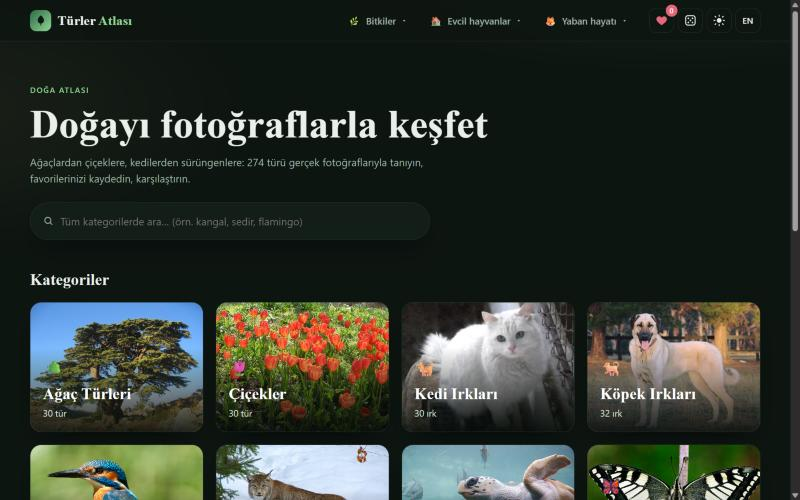

## Ekran görüntüleri

| Açılır kategori menüsü | Detay penceresi |
|---|---|
| 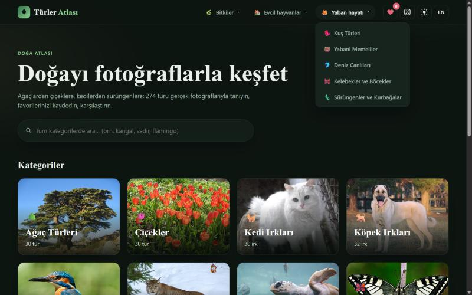 | 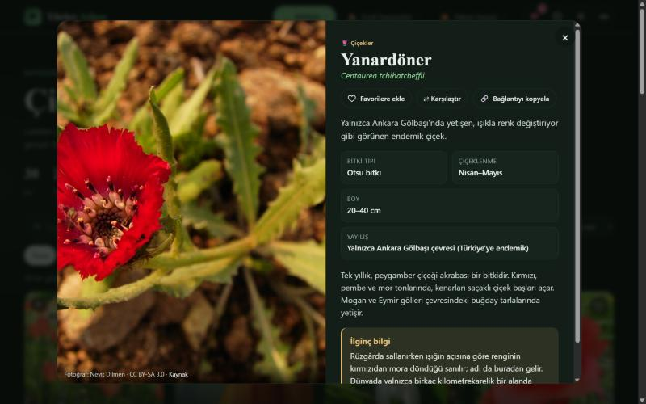 |

| Yabani memeliler | Deniz canlıları |
|---|---|
| 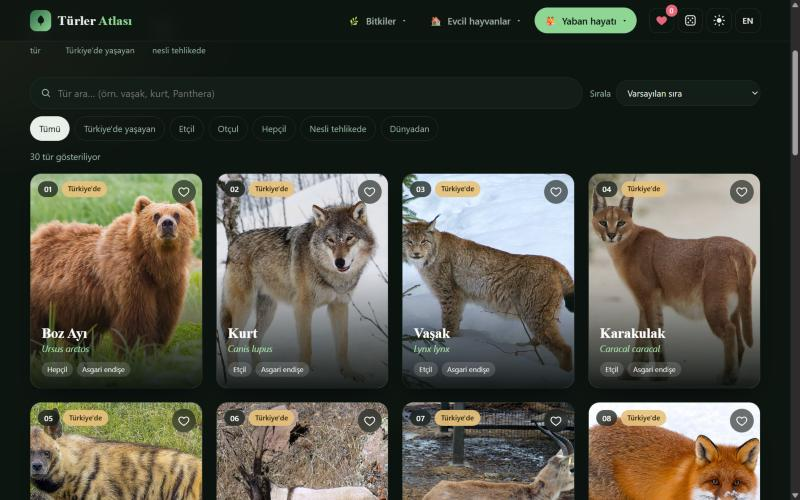 | 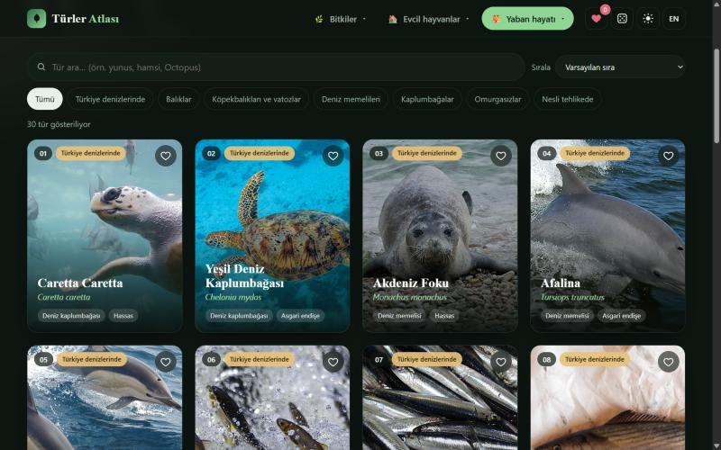 |

| Çiçekler | Kelebekler ve böcekler |
|---|---|
| 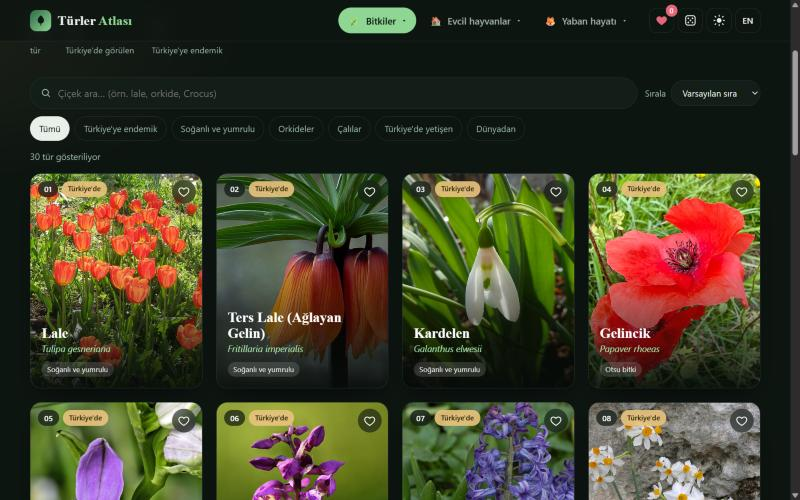 | 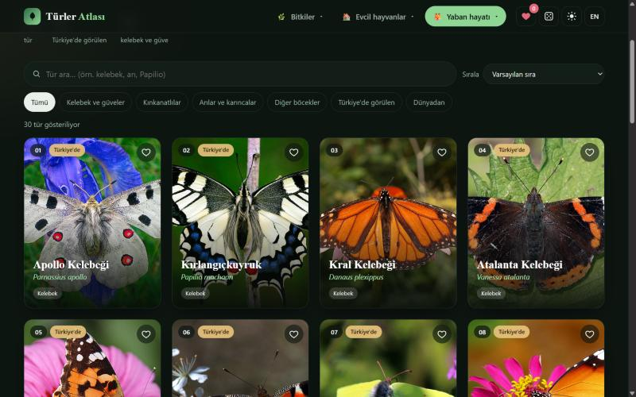 |

| Sürüngenler ve kurbağalar | Favoriler |
|---|---|
| 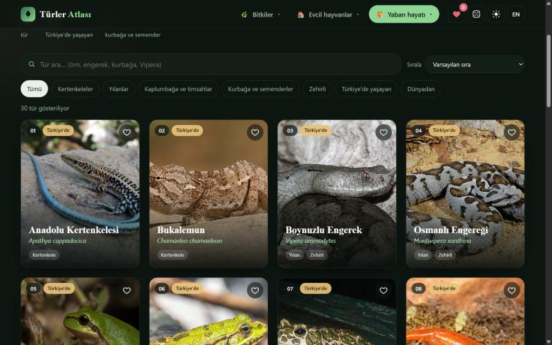 | 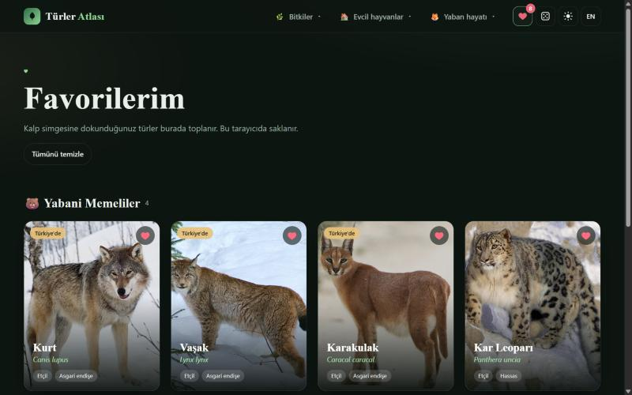 |

| Karşılaştırma | Aydınlık tema |
|---|---|
| 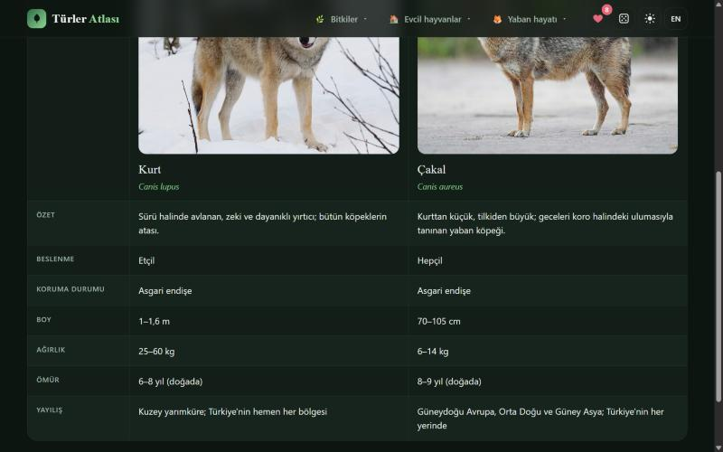 | 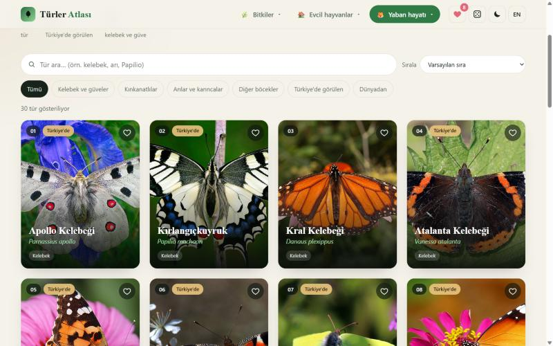 |

| İngilizce arayüz | |
|---|---|
| 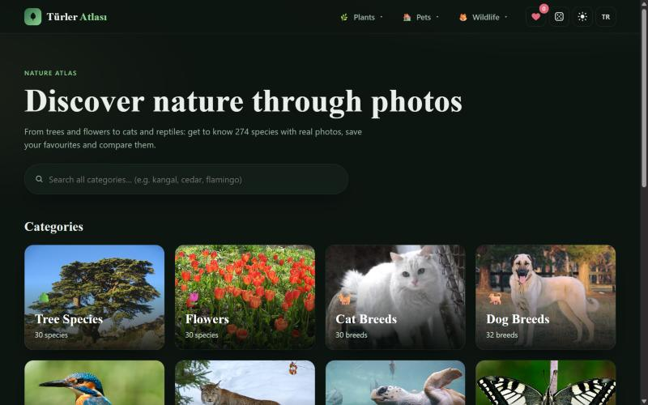 | |

| Tür kartları | Detay penceresi |
|---|---|
| 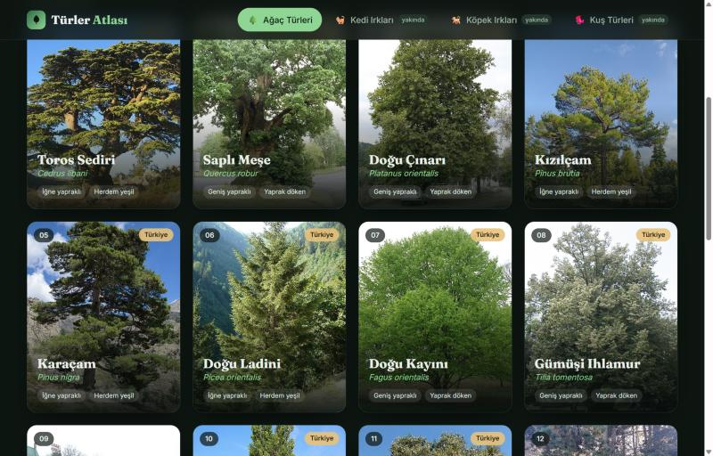 | 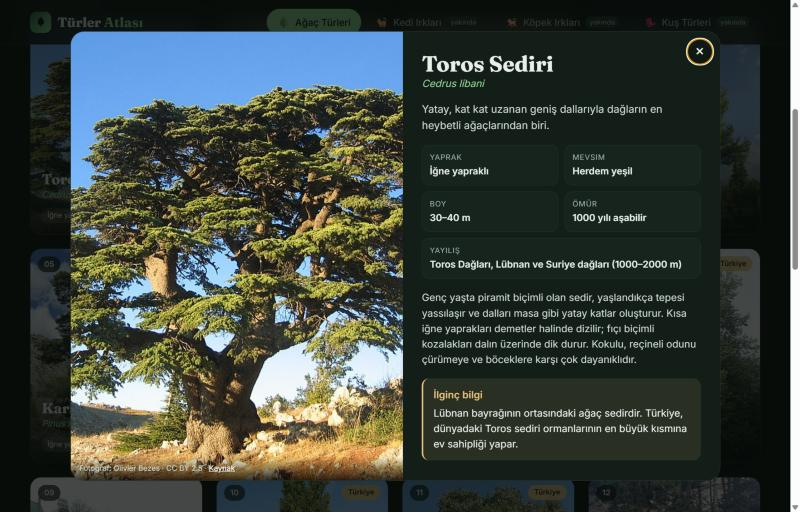 |

| Kedi ırkları | Kedi detay penceresi |
|---|---|
| 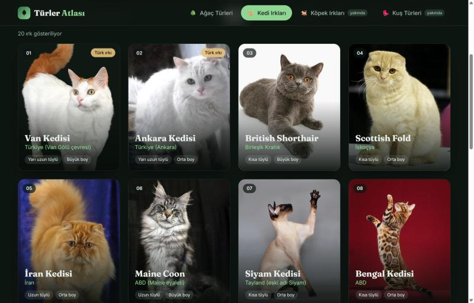 | 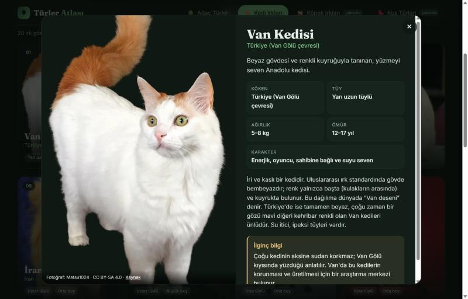 |

| Köpek ırkları | Köpek detay penceresi |
|---|---|
| 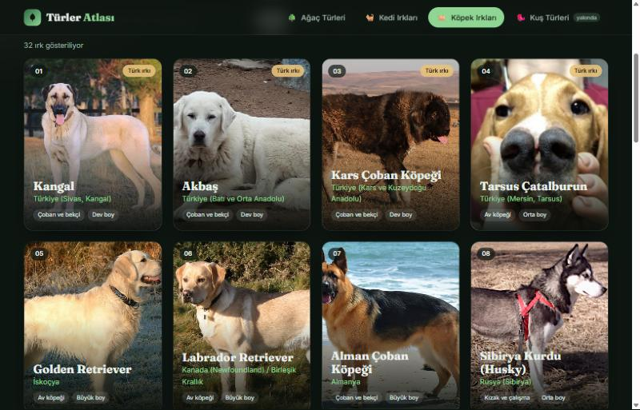 | 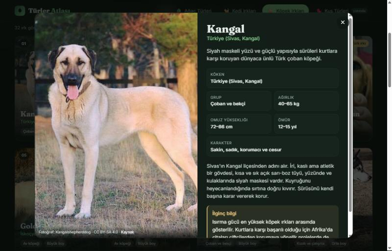 |

| Kuş türleri | Kuş detay penceresi |
|---|---|
| 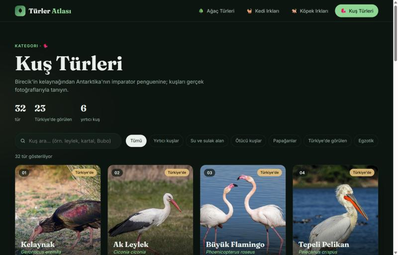 | 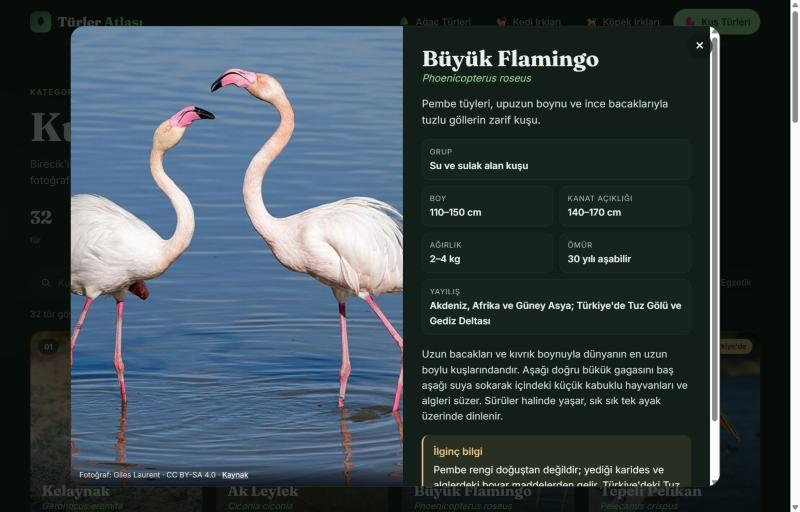 |

| Meyve ve süs ağaçları | Mobil görünüm |
|---|---|
| 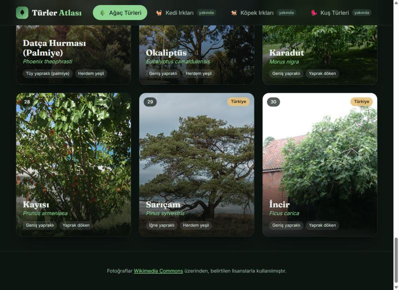 | 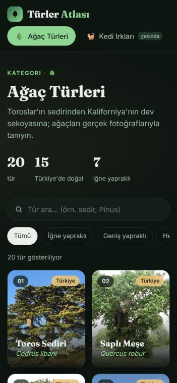 |

## Özellikler

- **Ana sayfa:** Kategori kartları, tüm kategorilerde ortak arama ve her gün değişen “Günün türü”
- **Gruplu açılır menü:** 🌿 Bitkiler (Ağaç Türleri, Çiçekler) · 🏠 Evcil hayvanlar (Kedi, Köpek) · 🦊 Yaban hayatı (Kuşlar, Yabani Memeliler, Deniz Canlıları, Kelebekler ve Böcekler, Sürüngenler ve Kurbağalar)
- **Favoriler:** Kartlardaki ♡ ile tür kaydedilir, üst bardaki sayaçla favoriler sayfasına gidilir (tarayıcıda saklanır)
- **Sıralama:** Ada, boya, ağırlığa, ömre ve kanat açıklığına göre (ton, kg, g, m, cm birimleri doğru karşılaştırılır)
- **Karşılaştırma:** Aynı kategoriden iki tür yan yana (`#karsilastir/memeliler/kurt,cakal`)
- **Paylaşılabilir bağlantılar:** Her türün kendi adresi vardır (`#memeliler/vasak`), “Bağlantıyı kopyala” düğmesiyle paylaşılır
- **Rastgele tür**, **aydınlık/karanlık tema** ve **Türkçe/English** dil seçeneği (tercihler hatırlanır)
- **Türü iyi gösteren fotoğraflar:** Her ağaç için ağacın tamamını gösteren fotoğraf seçildi (Wikimedia Commons)
- **Arama:** Ad, Latince ad, köken veya bölgeye göre (ş/ç/ğ gibi harfleri dikkate almadan)
- **Kategoriye özel filtreler:**
  - Ağaçlar: iğne yapraklı, geniş yapraklı, herdem yeşil, yaprak döken, Türkiye'de doğal
  - Kediler: kısa tüylü, uzun tüylü, tüysüz, büyük ırklar, Türkiye kökenli
  - Köpekler: küçük, orta, büyük ve dev, çoban ve bekçi, av köpekleri, Türk ırkları
  - Kuşlar: yırtıcı kuşlar, su ve sulak alan, ötücü kuşlar, papağanlar, Türkiye'de görülen, egzotik
  - Yabani memeliler: Türkiye'de yaşayan, etçil, otçul, hepçil, nesli tehlikede (IUCN), dünyadan
  - Deniz canlıları: Türkiye denizlerinde, balıklar, köpekbalıkları ve vatozlar, deniz memelileri, kaplumbağalar, omurgasızlar, nesli tehlikede
  - Çiçekler: Türkiye'ye endemik, soğanlı ve yumrulu, orkideler, çalılar, Türkiye'de yetişen, dünyadan
  - Kelebekler ve böcekler: kelebek ve güveler, kınkanatlılar, arılar ve karıncalar, diğer böcekler, Türkiye'de görülen, dünyadan
  - Sürüngenler ve kurbağalar: kertenkeleler, yılanlar, kaplumbağa ve timsahlar, kurbağa ve semenderler, zehirli, Türkiye'de yaşayan, dünyadan
- **Detay penceresi:** Kategoriye göre bilgi kutuları (ağaçta boy/ömür/yayılış, kedide köken/tüy/ağırlık/karakter, köpekte grup/ağırlık/omuz yüksekliği/karakter, kuşta boy/kanat açıklığı/ağırlık/yayılış, memelide beslenme/koruma durumu/boy/ağırlık/ömür, deniz canlısında grup/koruma durumu/boy/ağırlık/ömür), açıklama, ilginç bilgi, fotoğrafçı ve lisans bilgisi
- Mobil uyumlu, kurulum gerektirmez (saf HTML + CSS + JavaScript)

## Ağaç türleri

Toros Sediri · Saplı Meşe · Doğu Çınarı · Kızılçam · Karaçam · Doğu Ladini · Doğu Kayını · Gümüşi Ihlamur · Salkım Söğüt · Kara Kavak · Zeytin · Japon Akçaağacı · Siğil Huş · Boylu Ardıç · Akdeniz Servisi · Dev Sekoya · Afrika Baobabı · Japon Kirazı · Anadolu Sığlası · Anadolu Kestanesi · Toros Göknarı · Ceviz · Yalancı Akasya · Büyük Çiçekli Manolya · Datça Hurması (Palmiye) · Okaliptüs · Karadut · Kayısı · Sarıçam · İncir

## Kedi ırkları

Van Kedisi · Ankara Kedisi · British Shorthair · Scottish Fold · İran Kedisi · Maine Coon · Siyam Kedisi · Bengal Kedisi · Ragdoll · Sfenks (Sphynx) · Rus Mavisi · Norveç Orman Kedisi · Habeş Kedisi · Exotic Shorthair · Birman · Sibirya Kedisi · Devon Rex · Bombay Kedisi · Mısır Mau · Savannah Kedisi · Amerikan Kısa Tüylü · Burma Kedisi · Manx · Cornish Rex · Somali Kedisi · Himalaya Kedisi · Chartreux · Japon Bobtail · Ocicat · Munchkin

## Köpek ırkları

Kangal · Akbaş · Kars Çoban Köpeği · Tarsus Çatalburun · Golden Retriever · Labrador Retriever · Alman Çoban Köpeği · Sibirya Kurdu (Husky) · Alaska Malamutu · Border Collie · Beagle · Pug · Fransız Bulldog · İngiliz Bulldog · Chihuahua · Pomeranian · Shiba Inu · Akita Inu · Rottweiler · Doberman · Dalmaçyalı · Kaniş (Poodle) · Yorkshire Terrier · Jack Russell Terrier · Dachshund · Saint Bernard · Bernese Dağ Köpeği · Samoyed · Pembroke Welsh Corgi · Afgan Tazısı · Danua · Maltız

## Kuş türleri

Kelaynak · Ak Leylek · Büyük Flamingo · Tepeli Pelikan · Kaya Kartalı · Gökdoğan · Puhu · Peçeli Baykuş · Kara Akbaba · Turna · Kızılgerdan · Serçe · Kırlangıç · Yalıçapkını · Arıkuşu · İbibik · Saka · Karatavuk · Saksağan · Kuzgun · Büyük Alaca Ağaçkakan · Tavus Kuşu · Muhabbet Kuşu · Sultan Papağanı · Mavi-Sarı Ara · Toko Tukanı · İmparator Penguen · Devekuşu · Yakut Boğazlı Sinekkuşu · Kel Kartal · Kuğu · Kaya Güvercini

## Yabani memeliler

Boz Ayı · Kurt · Vaşak · Karakulak · Çizgili Sırtlan · Yaban Keçisi · Ceylan · Kızıl Tilki · Porsuk · Kafkas Sincabı · Yaban Domuzu · Kızıl Geyik · Alageyik · Kirpi · Su Samuru · Çakal · Yaban Tavşanı · Aslan · Kaplan · Afrika Fili · Zürafa · Kutup Ayısı · Dev Panda · Çita · Batı Gorili · Ova Zebrası · Kızıl Kanguru · Su Aygırı · Borneo Orangutanı · Kar Leoparı

## Deniz canlıları

Caretta Caretta · Yeşil Deniz Kaplumbağası · Akdeniz Foku · Afalina · Tırtak (Kısa Gagalı Yunus) · İnci Kefali · Hamsi · Palamut · Lüfer · Levrek · Kalkan · Orfoz · Kılıç Balığı · Orkinos · Ahtapot · Mürekkep Balığı · Denizatı · Kırmızı Deniz Yıldızı · Mavi Köpekbalığı · Varil Denizanası · Ay Balığı · Balina Köpekbalığı · Mavi Balina · Kambur Balina · Orka (Katil Balina) · Büyük Beyaz Köpekbalığı · Büyük Çekiç Başlı Köpekbalığı · Dev Manta Vatozu · Palyaço Balığı · Deniz Samuru

## Çiçekler

Lale · Ters Lale (Ağlayan Gelin) · Kardelen · Gelincik · Arı Orkidesi · Salep Orkidesi · Sümbül · Nergis · Siklamen (Tavşankulağı) · Safran Çiğdemi · Lavanta · Isparta Gülü · Zakkum · Beyaz Nilüfer · Papatya · Kokulu Menekşe · Süsen · Yanardöner · Kar Çiçeği · Ankara Çiğdemi · Beyaz Sternbergia · Güve Orkidesi · Lotus · Rafflesia · Ayçiçeği · Ortanca · Edelweiss (Aslanpençesi) · Krizantem (Kasımpatı) · Yıldız Çiçeği (Dalya) · Cennet Kuşu Çiçeği

## Kelebekler ve böcekler

Apollo Kelebeği · Kırlangıçkuyruk · Kral Kelebeği · Atalanta Kelebeği · Diken Kelebeği · Tavus Kelebeği · Limon Kelebeği · Sultan Kelebeği · Mavi Morpho · Atlas Güvesi · Kurukafa Güvesi · Bal Arısı · Uğur Böceği · Ateşböceği · Geyik Böceği · Peygamberdevesi · Gergedan Böceği · İmparator Yusufçuk · Ağustosböceği · Göçmen Çekirge · Bombus Arısı · Kutsal Bok Böceği · Kırmızı Orman Karıncası · Rosalia Teke Böceği · Avrupa Eşekarısı · Mayıs Böceği · Herkül Böceği · Orkide Peygamberdevesi · Goliath Böceği · Yaprak Kesen Karınca

## Sürüngenler ve kurbağalar

Anadolu Kertenkelesi · Bukalemun · Boynuzlu Engerek · Osmanlı Engereği · Ağaç Kurbağası · Ova Kurbağası · Gece Kurbağası · Likya Semenderi · İri Yeşil Kertenkele · Hazer Yılanı · Yarısu Yılanı · Hardun · Mahmuzlu Kaplumbağa (Tosbağa) · Benekli Su Kaplumbağası · Nil Kaplumbağası · Ev Kertenkelesi (Geko) · Nil Timsahı · Komodo Ejderi · Kırmızı Gözlü Ağaç Kurbağası · Boyacı Ok Kurbağası · Kral Kobra · Yeşil Anakonda · Galápagos Dev Kaplumbağası · Yeşil İguana · Aksolotl · Panter Bukalemunu · Leopar Geko · Amerikan Aligatoru · Tuatara · Fırfırlı Kertenkele

## Çalıştırma

Kurulum yok. `index.html` dosyasını tarayıcıda açmanız yeterli (fotoğraflar internetten yüklendiği için bağlantı gerekir).

### GitHub Pages'te yayınlama

1. Repoyu GitHub'a yükleyin.
2. **Settings → Pages → Build and deployment** bölümünde *Source* olarak **Deploy from a branch**, dal olarak `main` ve klasör olarak `/ (root)` seçin.
3. Birkaç dakika içinde site `https://<kullanici-adi>.github.io/turler-atlasi/` adresinde yayında olur.

## Proje yapısı

```
turler-atlasi/
├── index.html            # Sayfa iskeleti
├── css/style.css         # Tema ve düzen
├── js/i18n.js            # Arayüz metinleri (TR/EN)
├── js/app.js             # Menü, ana sayfa, arama, filtre, sıralama, favoriler, karşılaştırma
├── data/agaclar.js       # Ağaç türleri verisi
├── data/kediler.js       # Kedi ırkları verisi
├── data/kopekler.js      # Köpek ırkları verisi
├── data/kuslar.js        # Kuş türleri verisi
├── data/memeliler.js     # Yabani memeliler verisi
├── data/cicekler.js      # Çiçek türleri verisi
├── data/deniz.js         # Deniz canlıları verisi
├── data/bocekler.js      # Kelebek ve böcek türleri verisi
├── data/surungenler.js   # Sürüngen ve kurbağa türleri verisi
├── data/en.js            # Türlerin İngilizce metinleri
├── scripts/dogrula.js    # Veri doğrulama (GitHub Actions'ta çalışır)
├── screenshots/          # README görselleri
└── .github/workflows/check.yml
```

## Yeni kategori eklemek

1. `data/` klasörüne örneğin `baliklar.js` ekleyin ve `window.BALIKLAR = [...]` şeklinde veriyi tanımlayın.
2. `index.html` içinde `<script src="data/baliklar.js"></script>` satırını `app.js`'den önce ekleyin.
3. `js/app.js` içindeki `KATEGORILER` listesine yeni kategoriyi ekleyin: kart etiketleri, detay bilgi kutuları, istatistikler ve filtreler (diğer kategorilere bakabilirsiniz); `grup` alanı kategorinin hangi açılır menüde (`bitkiler`, `evcil`, `yaban`) görüneceğini belirler. Verisi henüz eklenmemiş bir kategori menüde "yakında" etiketiyle görünür.
4. Fotoğrafta önemli kısım kırpılıyorsa `foto.konum` alanıyla (ör. `"80% 50%"`) kartta görünecek bölgeyi ayarlayabilirsiniz.
5. `js/i18n.js` içine kategorinin Türkçe ve İngilizce metinlerini, `data/en.js` içine türlerin İngilizce çevirilerini ekleyin.
6. `scripts/dogrula.js` içindeki `ALANLAR` ve `KAT` listelerine yeni kategoriyi ekleyin.

## GitHub Actions

Her push'ta `Site kontrolü` iş akışı çalışır: JavaScript dosyalarının söz dizimini kontrol eder ve `scripts/dogrula.js` ile her türde gerekli alanların (ad, Latince ad, fotoğraf, lisans vb.) eksiksiz olduğunu doğrular. Ek paket kurulumu gerektirmez.

## Fotoğraf hakları

Tüm fotoğraflar [Wikimedia Commons](https://commons.wikimedia.org) üzerinden, sahiplerinin seçtiği özgür lisanslarla (CC BY, CC BY-SA, CC0, kamu malı) kullanılmaktadır. Her fotoğrafın yazarı, lisansı ve kaynak bağlantısı sitede ilgili türün detay penceresinde ve `data/agaclar.js` dosyasında yer alır.
